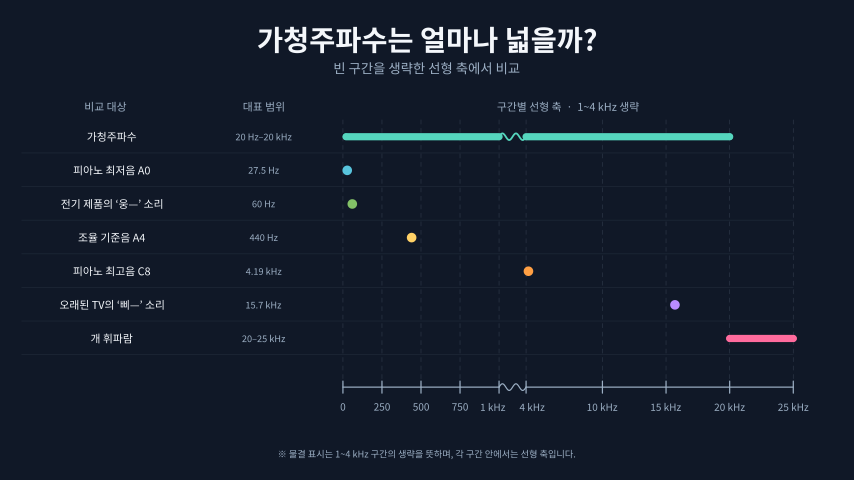

## 소리는 어떻게 표현될까?

### 소리는 진동이다

소리는 어떻게 만들어질까? 소리는 기타와 피아노처럼 줄을 쳐서도 만들어지기도 하고, 북을 쳐서 만들어지기도 하고, 피리처럼 좁은 관을 통과하며 만들어지기도 한다. 이 모든 과정은 공기중에 떨림, 즉 진동을 만들어낸다. 줄의 진동은 공기를 밀어내며 연쇄적으로 주변의 공기 분자들을 움직이게 만든다. 피리의 경우는 입으로 불어넣은 공기가 제트(좁고 빠르게 흐르는 공기)가 되어 진동을 만들고 관 안에서 공명하며 더 큰 주파수를 만들어낸다. 이렇게 만들어진 진동은 고막으로 전달되고, 고막의 흔들림을 달팽이관을 통해 전기 신호로 바꾸어 뇌는 마침내 소리를 인식하게 된다. 길게 말했지만, 결국 소리는 진동일 뿐이라는 말이다.

### 고음과 저음, 주파수(frequency)

어떤 진동은 고음이 되고 어떤 진동은 저음이 되는걸까? 이는 주파수와 관련되어 있다. 주기가 짧으면, 즉 고주파가 된다면 달팽이관의 상대적으로 단단한 부분이 흔들리게 만들고 주기가 길면 달팽이관의 유연한 부분을 흔들게 만든다. 이를 뇌는 각각 고음과 저음으로 인식하게 된다.

주파수는 Hz(헤르츠) 단위를 사용하며 1Hz는 1초에 1번의 진동이 일어났음을 의미한다.

### 큰소리와 작은소리, 진폭(amplitude)

어떤 소리가 크게 들리고 어떤 소리가 작게 들리게 될까? 이는 진동의 높낮이에 따라 달라진다. 진동의 최대 높이와 최소 높이의 차이(변위)를 진폭이라고 부른다. 진폭이 크면 달팽이관도 더 크게 흔들리며, 같은 유모세포(소리를 인식하는 기관)가 더 강한 자극을 받고 뇌는 큰 소리로 인식하게 된다.

소리는 파스칼과 데시벨이라는 단위를 쓴다. 파스칼은 압력을 나타내는 단위로 $N/m^2$(힘/면적) 즉 1m^2에 1N(뉴턴)의 힘이 가해지면 1Pa가 된다. 데시벨은 파스칼을 로그단위로 표현한 것인데 파스칼이 10배 커지면 20dB이 증가하는 식이다.

$$
L_p = 20\log_{10}\left(\frac{p}{p_0}\right)
$$

식에 대해 좀 더 알아보자.
우리가 흔히 음향기기에서 파스칼이 아닌 데시벨 단위를 쓰는 것은 숫자의 범위가 너무 커지기 때문이다.
소리의 세기(Intensity)는 음압(파스칼)의 제곱에 비례한다. 이는 $I = p * u$ 즉 음압 \* 공기입자의 진동 속도 이고, 평면 음파에서 진동 속도는 다시 음압에 비례하므로 이러한 식이 도출된다.

$$
I = \frac{p_{\mathrm{rms}}^2}{\rho c}
$$

이를 다시 로그로 표현하면 제곱이 내려오기 때문에 10배 변경에 20dB의 변화가 만들어진다. 이 이상 자세한 내용은 물리 시간이 아니므로 생략하겠다.

### 인간이 들을 수 있는 소리의 범위

인간이 들을 수 있는 소리의 범위, 가청주파수와 가청역치에 대해 알아보자.
들을 수 있는 소리의 높낮이는 가청주파수, 들을 수 있는 소리의 크기는 가청역치이다.



인간의 가청주파수는 20Hz ~ 20KHz 이다. 반면 개의 가청주파수는 약 40~60 Hz ~ 45~65 kHz로 인간보다 더 고주파의 소리를 들을 수 있다.

가청 역치는 0dB SPL부터 인간이 들을 수 있는 가장 작은 소리로 친다. (0dB라고 소리가 없는 상태가 아님에 주의) SPL은 Sound Pressure Level의 약자로, dB SPL은 음압을 20 µPa 기준으로 표현한 dB를 말한다. 이는 사람의 가청역치에 맞춰 만들어낸 표현이라 보면 된다. 인간이 들을 수 있는 가장 큰 소리는 대략 120~130 dB SPL이다. 물리적으로 이때부터 듣지 못한다기보단 이때부터 통증을 느끼기 시작하며 고막이 손상되기 시작하기 한다.

### 파형에 따라 달라지는 음색

같은 주파수(Hz), 같은 크기(dB)의 소리는 어떻게 구분할까? 예를 들어 피아노의 도레미와 바이올린의 도레미는 어떻게 구분할까? 이를 구분하는 것이 음색(timbre)이다.

예를 들어, 피아노와 바이올린의 도(C4)는 약 261.6Hz인데, 둘의 주파수는 시간에 따른 모양이 다르다. 즉, 패턴이 다르기 때문에 다르게 인식한다는 것이다. 피아노는 파형이 첫음이 크고 시간이 지나며 빠르게 감쇠하는 패턴이다. 바이올린은 시작인 피아노보다 작지만 파형이 일정하고 미세한 흔들림도 들어간다.

달팽이관은 소리를 여러 주파수로 분석해 각 주파수의 강도에 따라 이를 전기 신호로 바꾸며, 뇌는 이를 캐치하고 강도 및 패턴을 이해해 어떤 소리인지 구분해낸다.

## 소리를 디지털로 표현하기

아날로그 소리를 디지털로 표현하는 것은 어떻게 가능할까? 소리를 디지털로 변환하기 위해선

1. 소리를 일정한 시간 간격으로 측정하고
2. 이를 디지털 표현으로 변환해야한다.

이 과정을 PCM(Pulse Code Modulation, 펄스 부호 변조)라고 한다.

### 소리를 숫자로 기록하는 샘플 그리고 샘플레이트

샘플은 시간에 따른 파형의 진폭을 숫자로 기록한 값이다. 샘플값이 크면 큰소리, 작으면 작은 소리로 표현된다. 소리를 샘플로 바꾸는 것을 샘플링이라고 한다.

샘플레이트(sample rate)는 1초에 몇 개의 샘플이 들어가는지를 나타내는 것이다. 44.1kHz는 1초에 44100개의 샘플이 들어가게 된다. 샘플레이트가 높을수록 더 고주파를 기록할 수 있다. 44.1kHz 샘플레이트라고 해서 44.1kHz까지 표현할 수 있는 것은 아니고, 실제로는 최대 22.05kHz까지 표현할 수 있다. 이는 손실 없이 디지털 신호(샘플)를 아날로그로 복원하기 위해선 샘플레이트의 절반까지만 소리를 기록할 수 있기 때문인데, 그 내용은 여기서 다루지 않겠다. 내용이 어렵기 때문에 궁금한 사람은 나이퀴스트-샤논 샘플링 정리를 찾아보도록 하자.

### 진폭의 이산화, 양자화

샘플링 과정에서 샘플은 이론적으로 무한히 정밀한 값을 가질 수 있기 때문에 (예를 들면 0.123456789같은 값) 컴퓨터에 샘플값을 저장하기 위해선 양자화(Quantization)가 필요하다.

양자화는 표현 가능한 값의 개수를 제한하는 것을 말한다. 예를 들어 signed 3bit로 양자화한다고 하면

| 원본 샘플 범위     | 양자화 코드 | 이진수 |
| :----------------- | :---------: | -----: |
| -1.00 ~ -0.75 미만 |     -4      |    100 |
| -0.75 ~ -0.50 미만 |     -3      |    101 |
| -0.50 ~ -0.25 미만 |     -2      |    110 |
| -0.25 ~ 0.00 미만  |     -1      |    111 |
| 0.00 ~ 0.25 미만   |      0      |    000 |
| 0.25 ~ 0.50 미만   |      1      |    001 |
| 0.50 ~ 0.75 미만   |      2      |    010 |
| 0.75 ~ 1.00        |      3      |    011 |

위 표와 같이 특정 범위에 들어간 샘플은 하나의 양자화된 코드로 치환해버린다. 낮은 bit로 양자화할수록 치환하는 샘플 범위가 넓어지기 때문에 원본 샘플에 손실이 일어난다. 반대로 높은 bit로 양자화하면 그만큼 원본 샘플과 유사한 소리를 기록할 수 있게 된다.

우리가 듣는 음원은 대게 16bit 양자화를 사용하며 이정도면 인간이 손실을 눈치채지 못할 만큼 작아진다.

### 모노와 스테레오, 채널 이해하기

소리를 1개만 기록하면 모노, 왼쪽-오른쪽을 구분해서 기록하면 스테레오가 된다. 가끔 음악을 듣다보면 왼쪽만 드럼소리가 난다거나 한 적이 있다면 그것이 스테레오 채널로 소리를 기록한 것이다. 스테레오 채널을 통해서 각 채널이 전달하는 소리의 시간차, 위상차, 주파수 특성 차이 등을 이용해서 공간감과 방향감을 표현할 수도 있다.

두 샘플은 따로 저장하는게 아니라 하나의 PCM에 왼쪽 샘플1, 오른쪽 샘플1, 왼쪽 샘플2, 오른쪽 샘플2... 이런 식으로 번갈아가며 저장한다.

## 코덱과 컨테이너

지금까지 소리를 PCM 샘플로 기록하고, 여러 채널의 샘플을 배열하는 방법을 살펴봤다. 이제 이 데이터를 파일로 저장하고 전달하는 방법을 알아보자.

### PCM을 압축하는 방법, Codec

데이터를 인코딩(Encoding)하고 디코딩(Decoding)하는 규칙 또는 이를 구현한 소프트웨어 혹은 하드웨어를 지칭한다. (**Co**der와 **Dec**oder의 줄임말이다.) 앞서 소리 데이터를 PCM이라고 부르는 일련의 이진화된 시계열 데이터로 변환하는 과정을 거쳤다. PCM도 일종의 코덱으로 볼 수 있다. 하지만 실제로는 PCM을 다시 다른 코덱을 통해 더 효율적으로 저장&표현한다. 대표적으로 mp3,aac,flac등의 코덱이 있다.

그렇다면 왜 PCM을 바로 저장하지 않고 다시 다른 코덱으로 인코딩/디코딩 하는 것일까? 대게는 용량을 크게 줄일 수 있기 때문이다. 예를 들어 아주 단순한 형태의 코덱인 DPCM(Differential Pulse Code Modulation)은 PCM을 다음과 같이 변환한다.

```
# 원본 PCM
100, 102, 105, 99, 104

# DPCM
100, 2, 3, -6, 5
```

위 예시 처럼 첫 번째 PCM값을 기준으로 이전 샘플과의 차이만 저장한다. 이렇게 하면 숫자가 전체적으로 작아져 더 적은 bit를 사용하면서 원본 PCM으로 복원할 수 있다. 가령 위의 경우 -6 ~ 5 사이의 값만 저장할 수 있으면 되기 때문에 첫 샘플을 제외한 나머지 샘플들은 한 샘플당 Signed 4bit(-8~7 사이의 값을 저장할 수 있음)으로 저장할 수 있다. 원본이 16bit로 양자화한 결과였다면 75%를 절약하는 샘이다.

### 무손실 압축, FLAC

FLAC(Free Lossless Audio Codec)는 이름 그대로 손실 없이 PCM을 복원할 수 있는 코덱이다. FLAC의 핵심 아이디어는 예측(Prediction)과 잔차(Residual)이다.

예를 들어 원본 PCM이 다음의 형태라고 해보자.

```
100, 102, 104, 106, 108...
```

샘플이 2씩 증가하는 것을 볼 수 있다. 그렇다면 FLAC는 **An = An-1 + 2**라는 점화식과 잔차(점화식과 실측값의 차이)를 저장한다.

```
A0 = 100; A1 = 102
점화식: An = An-1 + 2
100, 102, 0, 0, 0
```

첫 샘플인 A0과 두 번째 샘플인 A1을 안다면 나머지는 점화식에 의거해 계산하고 그 오차를 더해 샘플값을 복원할 수 있다.

만약 샘플이 다음과 같았다면

```
100, 102, 105, 106, 110
```

FLAC는 다음과 같이 기록할 것이다.

```
A0 = 100; A1 = 102
점화식: An = An-1 + 2
100, 102, 1, 0, 2
```

물론 이 방식은 예측 식이 잘 맞을 때는 압축률이 좋겠지만, 예측을 크게 틀린다면 압축률이 떨어지는 방식이다.

### 손실 압축, MP3, AAC

MP3와 AAC는 FLAC와 다르게 코덱으로 인코딩을 하면 정보가 손실되어 원복할 수 없는 **손실 압축**방식이다.

MP3(MPEG Audio Layer III)는 PCM 오디오를 주파수 영역으로 변환한 다음, 청각적으로 덜 중요한 정보를 줄여서 압축한다.

MP3는 다음의 흐름을 따른다.

1. 필터뱅크(Filter Bank): 먼저 오디오를 주파수 대역에 따라 분리한다. 32개의 대역으로 쪼갠다.
2. MDCT(Modified Discrete Cosine Transform): 분리한 주파수 대역을 다시 cos계수의 합으로 표현해, 사용된 계수를 구한다. 왜 그렇게 하는지는 다루지 않겠지만 압축 효율이 좋아진다고 이해하면 된다.
3. 심리음향 모델(Psychoacoustic Model): 인간이 청각적으로 약하게 듣는 소리 정보의 표현에 사용하는 비트를 줄인다. 예를 들어, 큰 소리가 나면 작은 소리는 묻히므로 작은 소리에 저장하는 저장 공간을 줄이는 식이다.
4. 양자화(Quantization): MDCT 변환해 얻은 계수를 양자화한다. 압축효율을 높이기 위함이다. 이 단계에서 정보 손실이 발생한다.
5. 허프만 부호화(Huffman Coding): 자주 등장하는 값을 짧은 비트로 치환해 압축하는 방식이다.

내용이 많았지만, 복합적으로 이런저런 기법을 사용해 저장 효율을 높이고 압축했으며, 일부 정보 손실을 감수하고 압축 효율을 높인 방식의 코덱이라 보면 된다.

AAC는 MP3와 비슷하게 인간의 청각 특징을 사용하는 압축 방식으로, 압축하는 단계는 동일하다.(MDCT~허프만 부호화) 하지만 중간 과정에 사용된 개별 알고리즘과 압축 도구를 변경해 압축 효율을 더 극대화 했다볼 수 있다. 때문에 AAC는 같은 용량에서 MP3보다 더 높은 음질을 제공한다.

### 얼마나 정보 손실을 감수할 것인가? 비트레이트

비트레이트는 오디오 1초를 표현하는 데 사용하는 데이터의 비트 수를 말한다. 따라서 비트레이트가 올라가면 음질이 높아진다.(1초에 표현하는 정보가 더 풍부해지므로) 단위는 bps(bit per sec)을 사용하며 128kbps는 1초를 128,000비트로 표현한다고 보면 된다.

압축 손실에서 비트레이트를 높이면 용량은 늘어나지만 손실되는 데이터가 적어지고, 비트레이트를 낮추면 용량은 줄고 손실되는 데이터가 커진다고 보면 된다. 다만 비트레이트를 128kbps에서 256kbps로 올린다고 음질이 2배로 좋아지는 것은 아니다. 1초에 256kbps만큼 쓸 수 있게 된거지, 정보를 2배 더 보존할 수 있게 된 것은 아님에 유의하자.

### 여러 코덱과 메타정보를 묶어 저장하는 방법, Container

오디오 컨테이너는 소리 데이터와 관련 정보를 파일 안에 담는 **형식**이다. 컨테이너는 코덱과 재생에 필요한 정보를 어떻게 배치할지 정한다. 예를 들어 파일의 코덱 정보, 재생 시간, 여러 오디오·비디오 트랙 등을 담을 수 있다.

MP3의 경우 인코딩한 결과가 압축한 소리 데이터와 이를 해석할 프레임 헤더가 함께 들어 있다. 헤더에는 샘플레이트, 비트레이트, 채널 모드 등의 정보가 있기 때문에 컨테이너가 없어도 재생 가능하다.

그렇다면 코덱으로 인코딩한 것으로도 재생할 수 있는데 컨테이너는 왜 필요할까? 컨테이너는 미디어 데이터와 이를 다루는 데 필요한 정보를, 여러 프로그램이 같은 규칙으로 저장하고 읽도록 묶기 위해 존재한다.

예를 들어 코덱이 프레임을 해석할 정보를 갖고 있지 않은 경우 컨테이너가 이를 들고 있기도 하고(WAV), 소리, 영상, 트랙 등의 다양한 미디어 데이터를 함께 들고 있는 용도(MP4)로 사용하기도 한다.

### 오디오 데이터를 그대로 저장하는 컨테이너, WAV

Wav는 Waveform Audio File의 약자로, 오디오 데이터를 담는 용도의 컨테이너이다. 보통 `.wav` 확장자를 쓴다. 보통은 압축되지 않은 PCM을 담지만 압축된 오디오도 담을 수 있다.

WAV는 RIFF(Resource Interchange File Format)라는 구조를 사용하며, 정보를 용도별 청크로 나눠 저장한다. 일반적인 PCM WAV 파일은 다음처럼 구성된다.

```
RIFF 청크
├─ 파일 크기 정보
├─ "WAVE"              → WAV 형식임을 표시
├─ "fmt " 청크         → 오디오 데이터의 형식 (공백 오타 아님)
├─ "data" 청크         → 실제 오디오 데이터
└─ 그 밖의 청크        → 곡명, 저작권, 녹음 정보 등
```

여기서 fmt는 바이너리 데이터 구조로 다음과 같이 각 bit에 정보를 표현한다.

| 필드            | 저장 크기 |  예시 값 | 의미                                                                                                                       |
| --------------- | --------: | -------: | -------------------------------------------------------------------------------------------------------------------------- |
| `audioFormat`   |   2바이트 |      `1` | 오디오 데이터의 인코딩 형식 (1이면 PCM을 가리킴)                                                                           |
| `numChannels`   |   2바이트 |      `2` | 채널 수                                                                                                                    |
| `sampleRate`    |   4바이트 |  `44100` | 채널별로 1초에 재생할 샘플 수                                                                                              |
| `byteRate`      |   4바이트 | `176400` | 비트레이트                                                                                                                 |
| `blockAlign`    |   2바이트 |      `4` | 한 번에 처리하는 최소 데이터 단위의 바이트 수 (2채널이고 왼쪽 샘플 2byte, 오른쪽 샘플 2byte인 경우 blockAlign은 4가 된다.) |
| `bitsPerSample` |   2바이트 |     `16` | 한 샘플의 크기 (bit 단위) 수                                                                                               |

### 오디오 데이터를 교환할 수 있는 표준화된 파일 구조, MP4
